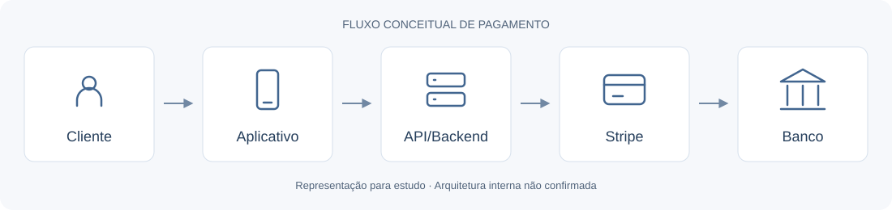

# Payment Integration Case Study

Estudo de caso sobre uma investigação de pagamentos Pix durante um estágio em tecnologia, na perspectiva de estudantes de Análise e Desenvolvimento de Sistemas.

> O diagrama é conceitual. A investigação não confirmou a causa do comportamento observado e não resultou em correção de código.

## Objetivo e contexto

Compreender por que, ao escanear um QR Code Pix, o aplicativo bancário apresentava uma solicitação de autorização de cobrança automática. A intenção era organizar informações para ajudar a equipe a esclarecer dúvidas de clientes e avaliar possíveis melhorias no checkout.

## Ferramentas e conceitos estudados

- **Stripe Dashboard:** pagamentos, assinaturas, faturas, produtos, metadados e eventos.
- **Documentação e suporte da Stripe:** consulta sobre Pix, recorrência e integração.
- **Conceitos de API:** PaymentIntent, Checkout Session, assinaturas e webhooks; sem implementação dessas APIs neste estudo.
- **Meios de pagamento:** pagamento avulso, faturamento recorrente e autorização bancária.

## Etapas realizadas

1. Identificar o comportamento relatado no pagamento.
2. Consultar os registros disponíveis no Dashboard.
3. Separar observações de hipóteses sobre a integração.
4. Consultar documentação e suporte técnico.
5. Organizar as informações e encaminhá-las à equipe de desenvolvimento.

## O que aprendi na prática

- Navegar pelo Dashboard e relacionar pagamentos, assinaturas e próximas faturas.
- Entender inicialmente a comunicação entre aplicativo, backend e gateway de pagamento.
- Diferenciar uma assinatura cadastrada de uma autorização bancária para pagamentos futuros.
- Interpretar registros de API e reconhecer que parâmetros da integração podem diferir das configurações visíveis no painel.
- Formular hipóteses, consultar fontes e comunicar dúvidas aos desenvolvedores.
- Reconhecer limites de acesso e conhecimento, perguntar antes de alterar e ter cuidado com produção.

Os [aprendizados detalhados](docs/aprendizados.md) incluem dificuldades e conceitos que ainda precisam de aprofundamento.

## Resultados e limitações

Foi identificada uma assinatura trimestral ativa com próxima fatura programada, evidência de faturamento recorrente no sistema. Produtos com identificadores de planos e registros de criação por API sugeriram participação do aplicativo na gestão dos planos.

Essas observações **não demonstram que a assinatura causou a mensagem bancária**. A hipótese não foi confirmada. Não houve auditoria da arquitetura, implementação de APIs ou correção de código. O resultado foi o encaminhamento das informações à equipe.

## Documentação

| Documento | Conteúdo |
| --- | --- |
| [Contexto](docs/contexto.md) | Problema e escopo |
| [Metodologia](docs/metodologia.md) | Etapas e cuidados da investigação |
| [Evidências](docs/evidencias.md) | Fatos relatados, hipóteses e pontos não confirmados |
| [Arquitetura conceitual](docs/arquitetura.md) | Responsabilidades no fluxo de pagamento |
| [Aprendizados](docs/aprendizados.md) | Conhecimentos e dificuldades |
| [Conclusões](docs/conclusoes.md) | Resultados, limites e próximos passos |
| [Referências oficiais](docs/referencias.md) | Stripe: Pix, APIs, assinaturas e eventos |

Os exemplos de [pagamento único](examples/payment-one-time.json) e [pagamento recorrente](examples/payment-recurring.json) usam dados fictícios. São representações conceituais, não payloads oficiais executáveis da Stripe.

## Finalidade educacional

Este portfólio registra aprendizado de estágio, sem vínculo oficial com a Stripe ou outras instituições citadas. Não contém código proprietário, capturas de tela corporativas ou dados reais de clientes. Consulte os [cuidados de segurança e privacidade](SECURITY.md) e a [licença MIT](LICENSE).
