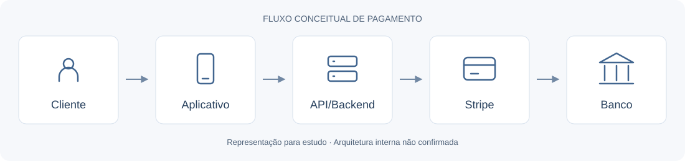

# Arquitetura conceitual

O fluxo **Cliente → Aplicativo → API/Backend → Stripe → Banco** é uma simplificação para estudo. As setas representam comunicação conceitual; não são uma sequência de chamadas confirmada. A arquitetura interna real não foi auditada.

| Participante | Responsabilidade ilustrativa |
| --- | --- |
| Cliente | Inicia o pagamento e avalia as informações apresentadas |
| Aplicativo/frontend | Exibe a interface de compra e orienta o usuário |
| API/backend | Aplica regras do produto e se comunica com serviços de pagamento |
| Stripe | Disponibiliza recursos de pagamento e faturamento usados por integrações |
| Banco | Apresenta ao cliente as etapas de pagamento ou autorização aplicáveis |

## Conceitos relacionados

- **PaymentIntent:** recurso para acompanhar o ciclo de um pagamento; não representa por si só uma assinatura.
- **Checkout Session:** recurso que representa uma sessão no Stripe Checkout; o modo e os meios disponíveis dependem da integração.
- **Subscription:** recurso de faturamento recorrente, relacionado a ciclos e faturas.
- **Webhook:** mecanismo para entregar eventos ao endpoint configurado pela integração. Não confirmamos como a aplicação original os tratava.

Configurações do Dashboard e parâmetros enviados pelo backend podem atuar em partes diferentes do fluxo. A disponibilidade de um recurso também depende das condições documentadas para conta, região e meio de pagamento.

## Pix, recorrência e intermediários

Uma assinatura cadastrada organiza faturamento. Uma autorização bancária para pagamentos futuros expressa consentimento no meio de pagamento. Não devem ser tratadas como equivalentes.

A relação entre Stripe, EBANX e instituições bancárias foi um tema de estudo sobre participantes e intermediários de pagamentos. A EBANX não é representada como etapa obrigatória neste diagrama: seu papel específico no caso não foi confirmado. O material não atribui a nenhuma dessas instituições a causa da mensagem observada.
